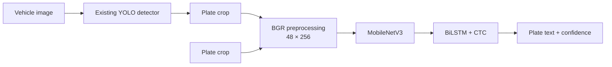

# Vietnamese License Plate OCR & ANPR

[](https://github.com/KD-Orbitan/anpr/actions/workflows/tests.yml)
[](https://github.com/KD-Orbitan/anpr/releases/latest)
[](https://www.python.org/)

**A reproducible computer-vision pipeline for reading Vietnamese license plates.** Fine-tune and evaluate a CRNN OCR recognizer, then use it with an existing YOLO detector through a CLI, Streamlit app, or FastAPI service.

> **Reported OCR result:** 92.98% full-plate exact match on 399 cropped plates. This is OCR-only, not end-to-end ANPR accuracy. Historical checkpoint-selection provenance remains under review; see [evaluation details](docs/RESULTS.md) before interpreting the numbers.

## Results

| OCR checkpoint | Exact match | Character error rate | Correct / samples |
| --- | ---: | ---: | ---: |
{{RESULTS_TABLE}}

These author-reported metrics are for OCR on plate crops. Evaluation images and labels are private and are not included, so the results cannot be independently reproduced from this repository. The project does not claim these values as detector or end-to-end ANPR performance.

## Pipeline



The crop-only OCR path does not need detector weights. Vehicle-image detection does. The OCR backbone, sequence model, and YOLO detector are reused components; this project focuses on fine-tuning, reproducibility, evaluation, data tooling, and application integration.

## Try OCR

1. Clone the repository and install the Python 3.9 CPU OCR runtime:

   ```bash
   git clone https://github.com/KD-Orbitan/anpr.git
   cd anpr
   python -m venv .venv
   # Activate .venv for your shell, then:
   python -m pip install -r requirements-ocr-cpu.txt
   python -m pip install -e .
   ```

2. Download [`ocr-models.zip` from the latest release](https://github.com/KD-Orbitan/anpr/releases/latest) and extract it into the repository root. The archive contains both OCR checkpoints and their matching character dictionary.

3. Generate a fictional input and run recognition:

   ```bash
   python scripts/generate_example.py
   python -m plateocr infer data/examples/fictional_plate.png --model model92
   ```

The generated image is only a wiring example; it is not a model-quality demonstration. For real inputs, provide an authorized plate crop. See [setup and asset locations](docs/SETUP.md) for details.

## Interfaces

| Interface | Use |
| --- | --- |
| CLI | Run OCR on a plate crop with `python -m plateocr infer IMAGE`. Add `--detect` for a vehicle image when authorized detector weights are available. |
| FastAPI | `POST /ocr` accepts a cropped plate; `POST /anpr` accepts a vehicle image. Start locally with `python -m uvicorn api:app --host 127.0.0.1 --port 8000`. |
| Streamlit | Launch the local app with `python -m streamlit run app.py`. |

`/anpr`, `--detect`, and vehicle-image detection in the app require a separately authorized YOLO checkpoint, which is not part of this release. The API is a local research/demo interface, not a production-hardened service.

## Engineering highlights

- **Consistent model contract:** BGR input, aspect-preserving resize, normalized padding, and fixed `[N, 3, 48, 256]` input across training and inference.
- **Reliable decoding and evaluation:** CTC blank/repeat handling, full-plate exact match and CER, with failed images retained in the accuracy denominator.
- **Reproducible experiments:** frozen run configs, manifests, dictionaries, checkpoints, and environment/hash metadata.
- **Data checks:** duplicate and conflicting-label audits, deterministic splits grouped by plate text, and vocabulary validation.
- **End-to-end tooling:** training, evaluation and export commands, model registry, CLI, Streamlit UI, FastAPI endpoints, and data-free tests.
- **Controlled publication:** separate source and full-release profiles; raw images, labels, and per-image predictions are excluded.

See the [engineering walkthrough](docs/ENGINEERING.md) for implementation decisions and validation evidence.

## Test the code

Run the lightweight suite in a separate test environment; it does not require Paddle, model weights, or private datasets:

```bash
python -m pip install -e ".[test]"
python -m unittest discover -s tests -v
python scripts/check_release.py
```

GitHub Actions runs the tests and release-inventory check on Windows and Linux. This verifies code contracts and packaging boundaries, not model quality.

## Scope and limitations

- Fine-tuned OCR weights are distributed separately in the [GitHub Release](https://github.com/KD-Orbitan/anpr/releases/latest); raw datasets, private labels, per-image predictions, the original pretrained checkpoint, and YOLO weights are not included.
- The reported evaluation uses private crop images. Historical checkpoint-selection provenance is not fully established, so these figures should not be presented as a verified untouched-holdout result.
- The public Kaggle training-data source is documented in the [dataset card](docs/DATASET_CARD.md); its license and the provenance of some historical augmented data still need confirmation.
- Full runtime validation is limited to Windows, Python 3.9, and CPU Paddle 2.6.2. GPU training and production deployment are not validated.
- No project-wide license is declared for the original code. See [third-party notices](docs/THIRD_PARTY_NOTICES.md) for bundled component terms.

## Project docs

[Engineering walkthrough](docs/ENGINEERING.md) · [Setup](docs/SETUP.md) · [Model card](docs/MODEL_CARD.md) · [Dataset card](docs/DATASET_CARD.md) · [Evaluation](docs/RESULTS.md) · [Third-party notices](docs/THIRD_PARTY_NOTICES.md)
